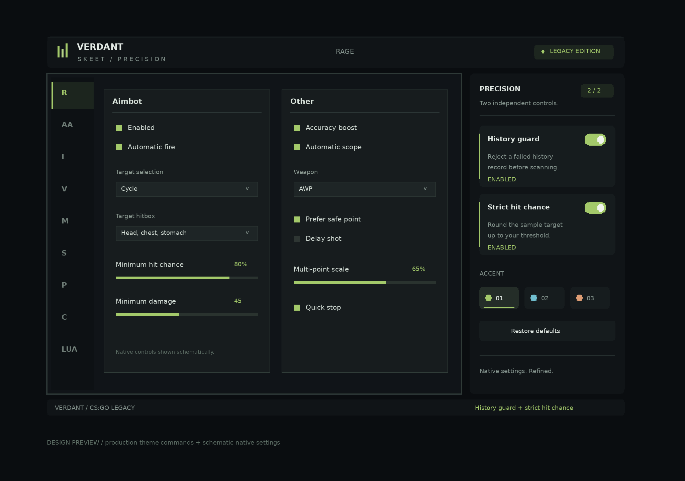

Скачать: [Skeet_Verdant_8802.zip](Skeet_Verdant_8802.zip?raw=true)

Макет оформления (не скриншот игры):

SHA-256 архива: `d4fa8d7e843437a1bb4ee272c8aec288de16a7c722d5f8f6a680e0fa87d27b09`

# Skeet / Verdant

Визуальное обновление той же DLL с двумя исправлениями сканирования.
За основу взята предыдущая рабочая сборка `Skeet_scan_patch_8802.zip`.
Это клиентская DLL для CS:GO Legacy x86; не серверный плагин.

## Вид и управление

- Графитовый фон с неброской сеткой, более спокойные панели и светлые подписи.
- Верхняя строка Verdant с названием активной вкладки.
- Боковая панель Precision с двумя переключателями и тремя цветовыми акцентами:
  зелёным, голубым и тёплым оранжевым.
- Плавное движение переключателей и подсветка при наведении.
- На небольшом экране, где боковая панель не помещается, два переключателя
  находятся справа в верхней строке.
- Родные вкладки, элементы и их расположение сохранены. При первом открытии
  меню центрируется с учётом новой панели. Потом его можно перемещать как раньше.

Панель располагается снаружи родных настроек и не накрывает их.
Акценты выбираются в панели Verdant; в этой теме они имеют приоритет над
старым выбором основного цвета в Misc. Исходные иконки вкладок сохранены.
Основной шрифт родных настроек не заменялся.

`Verdant_preview.png` — макет: новые внешние элементы нарисованы из тех же
команд, которые использует DLL, родные настройки показаны схематично.
Это не скриншот из запущенной игры.

## Два сохранённых исправления

По умолчанию оба включены, как в предыдущей сборке.

**History guard**: если выбранную историческую запись не удалось применить,
соответствующий путь сканирования прерывается через существующую очистку.

**Strict hit chance**: требуемое количество успешных проверок из 32
округляется вверх. При 80% требуется 26/32 вместо прежних 25/32.

Переключатели реально меняют эти два условия. Они не переписывают
исполняемый код при клике: меняются отдельные переменные вне ядра.
При выключении соответствующего переключателя возвращается исходное
поведение этого условия. `Restore defaults` включает оба и выбирает зелёный акцент.
Положение переключателей и выбранный акцент действуют до перезапуска;
с исходными конфигами чита они пока не сохраняются.

Нового алгоритма прогнозирования движения или резольвера в этой версии нет.

## Установка и откат

1. Закрой игру и сохрани прежние `skeet.dll` и `injector.exe` отдельно.
2. Распакуй оба файла из `bin/` в одну папку.
3. Используй прежний способ запуска предоставленного загрузчика.

Отдельный Lua для темы не нужен. Для отката полностью закрой игру и верни
предыдущую пару файлов. Две версии одновременно не загружай.

Целевая ветка пользователя — CS:GO Legacy 1.38.8.1, build 8802.
В Windows и в игре эта новая версия здесь не запускалась. Сохранившиеся
адреса интерфейсов исходной обвязки зависят от версии клиента.
Совместимость конкретных `client.dll`, `engine.dll` и Steam Overlay
пользователя в этой среде не проверена.

## Проверки и исходники

- Windows x86 DLL/EXE пересобраны; проверены PE32, ресурсы и строки темы.
- 49 995 проверок порога в x86-эмуляторе: исходный код и все четыре
  комбинации двух переключателей, три размещения кода.
- 180 сценариев применения записи и возврата/очистки, включая исходные
  ветки пустой истории и скачка позиции.
- Переключение состояния в работающем эмуляторе без записи в код.
- 48 сравнений исходной отрисовки с переходником: передача аргумента,
  порядок вкладок, видимость, восстановление стека и регистров.
- 27 вариантов сцен и 50 проверок взаимодействия: компоновка, удержание
  кнопки мыши, потеря фокуса, акценты, сброс и прозрачность.

Интерфейсы движка заменялись заглушками. Эти проверки не подтверждают
реальное отображение, клики в Windows или улучшение процента попаданий.
Отчёты находятся в `reports/`, контрольные суммы — в `SHA256SUMS.txt`.

В `source/` — изменённая обвязка и исходные бинарные ресурсы. Полный
высокоуровневый исходник ядра не восстановлен. Сам `skeet_cv.bin` сохранён
побайтно; изменения устанавливаются в его отображённый образ до расчёта
исходной контрольной суммы и запуска ядра.

Основа предыдущей DLL, SHA-256:
`f67f7ad3e1195b0f43ab9f40ce0769892590139facb6d95b1c14514830bbfe3b`.

Пересборка: зависимости из `requirements-build.txt`, затем
`python build_windows.py`. Для переносимых тестов на Linux нужен также `g++`.
Запуск проверок: `python tests/validate_scan_patch.py`,
`python tests/validate_menu_theme.py`, `python tests/validate_release.py`.
Для генерации макета дополнительно нужен Pillow.
